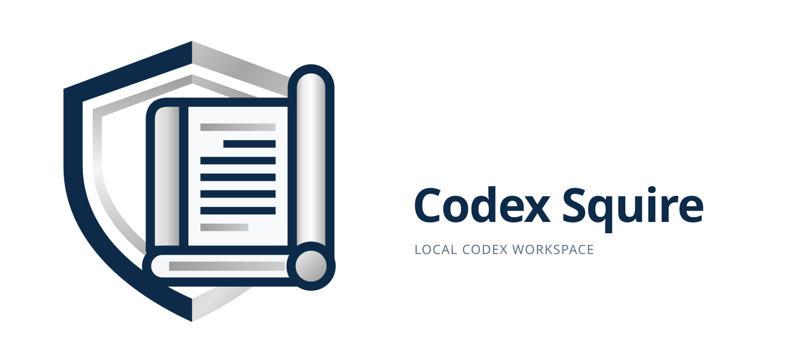

# Codex Squire

  

面向本地 Codex 的 Provider 管理与 Responses 网关。它在本机回环地址上保存多个上游来源，按可配置方案选择来源，转发 /v1/responses 的 JSON/SSE 请求，并记录可解释的用量与故障诊断信息。

Codex Squire 当前是一个**可运行的本地单用户网关，并提供 Tauri 开发版客户端骨架**。它已经完成 Provider、Scheme、网关转发、SSE 观察、原子额度准入和 React 管理界面的第一版闭环；会话、Prompt、OAuth 和远程多人部署仍不在当前范围内。

[快速开始](#快速开始) · [支持范围](#支持范围) · [架构](#架构) · [验证](#验证) · [已知限制](#已知限制)

## 当前状态

| 项目 | 当前结论 |
| --- | --- |
| 运行形态 | Java 后端与 React/Vite 网页端分别启动，默认只监听本机回环地址 |
| 使用对象 | 本机单用户、需要在多个 API Key Provider 之间路由 Codex 请求的开发者 |
| 网关协议 | POST /v1/responses，支持非流式 JSON 和 SSE 原始字节转发 |
| 数据存储 | SQLite WAL；配置、请求尝试、逻辑请求、额度和迁移记录持久化 |
| 凭据保护 | 管理令牌、网关令牌独立生成；Provider API Key 使用 AES-GCM 加密 |
| 客户端 | 已有 Tauri v2 启动器与运行时骨架，支持本地模式和受信任局域网服务模式；可通过 `scripts/package-release.ps1` 生成内置 JRE 的 Windows 便携式 ZIP |
| 稳定性边界 | 已覆盖基础并发准入、故障切换、取消和启动恢复；长期压测、账单对账和完整桌面发布尚未完成 |
| 许可证 | MIT |

## 目录

- [项目定位](#项目定位)
- [支持范围](#支持范围)
- [快速开始](#快速开始)
- [最小使用流程](#最小使用流程)
- [Codex 配置](#codex-配置)
- [限额、路由与重试语义](#限额路由与重试语义)
- [请求生命周期](#请求生命周期)
- [架构](#架构)
- [数据模型与可观测性](#数据模型与可观测性)
- [管理界面](#管理界面)
- [配置、备份与恢复](#配置备份与恢复)
- [桌面客户端](#桌面客户端)
- [从源码构建](#从源码构建)
- [验证](#验证)
- [项目结构](#项目结构)
- [已知限制](#已知限制)
- [后续路线图](#后续路线图)
- [参与开发](#参与开发)
- [品牌资源](#品牌资源)
- [许可证](#许可证)

## 项目定位

Codex Squire 解决的是本机 API 来源治理问题：把多个兼容 Responses API 的 Provider 放进可管理的方案中，由网关统一处理鉴权替换、候选选择、额度预留、SSE 转发和请求记录。

它适合：

- 在多个 API Key 或兼容服务之间按顺序或权重分配请求；
- 为每个 Provider 设置本地请求数、Token 和并发预算；
- 在不修改 Codex 请求内容的情况下使用本地网关；
- 查看一次逻辑请求对应的 Provider 尝试、用量口径和失败阶段；
- 在本机通过管理界面修改配置，并用真实 Responses 请求验证来源。

网关保留请求中的模型、input、工具、reasoning 和输出格式，不做模型改名、工具协议转换或 Chat Completions 转换。因此同一个 Scheme 中的 Provider 必须能处理相同的模型和请求字段。

## 支持范围

### 当前可用能力

| 领域 | 能力 |
| --- | --- |
| Provider | 创建、编辑、启用/禁用、删除；Base URL 与 API Key；HTTPS 和地址校验 |
| Scheme | ORDERED 和 BALANCED；成员顺序、权重、原子更新和激活 |
| 路由 | 过滤禁用/限额满/并发满的来源；准入失败后重新计算候选；每次请求每个成员最多尝试一次 |
| 网关 | 本地令牌鉴权、上游 API Key 替换、有限请求头透传、JSON/SSE 原始转发 |
| 用量 | SSE 分片 UTF-8、多行 data:、终态 usage、输入/输出/缓存 Token 观察 |
| 额度 | 分钟/小时/日/周/月窗口、请求数/Token/并发规则、BEGIN IMMEDIATE 原子预留 |
| 运行治理 | 429 Retry-After、失败退避、cooldown、成功恢复、手动清除冷却 |
| 诊断 | GatewayRequest、ProviderAttempt、attempt chain、终态、错误码、用量口径和日志导出 |
| 管理界面 | Overview、Providers、Schemes、Requests、Connection；配置版本冲突保护 |
| 工程能力 | 版本化迁移、checksum、启动恢复、实例锁、环境校验、Playwright 与 Codex CLI 冒烟测试 |

### 明确不支持

当前实现只承诺前台 Responses 请求，以下能力不要按已实现能力使用：

- OAuth、ChatGPT 账号和多账户会话；
- /v1/chat/completions 转换；
- background=true、previous_response_id、远程响应读取、删除响应和 /responses/compact；
- WebSocket；
- 跨请求会话管理、Session affinity 和 Prompt 管理；
- 完整供应商账单、成本指标和硬费用上限；
- 按模型维护的能力注册和后台自动探测调度；
- 系统凭据库、密钥轮换和完整生产桌面发布流程；当前 Tauri 客户端仍是开发版运行时；
- 远程多人部署、公网认证、TLS 终止和 RBAC。

Provider 探测是显式触发的真实 Responses/SSE/usage 检查，不等同于 /models 成功，也不会自动代表所有模型都兼容。

## 快速开始

### 环境要求

| 工具 | 要求 |
| --- | --- |
| Backend | Java 17、Spring Boot 3.5.16、Spring WebFlux、SQLite JDBC 3.53.4.0 |
| Frontend | React 18.3.1、TypeScript 5.7.2、Vite 6.4.3 |
| Windows | PowerShell 7；当前脚本和验证在 Windows 上维护 |
| Java | JDK 17；脚本会检查 JAVA_HOME 和 java.exe |
| Gradle | 使用仓库内 Gradle Wrapper 8.10.2 |
| Node.js | 22.12 或更高版本 |
| pnpm | 推荐使用锁定版本 12.3.4 |

### 启动两个本地进程

~~~powershell
git clone https://github.com/allenwu258/codex-squire.git
cd codex-squire
Copy-Item .env.example .env
notepad .env
~~~

至少填写 .env 中的 JAVA_HOME。默认配置使用：

~~~dotenv
SQUIRE_PORT=8787
SQUIRE_WEB_PORT=5173
SQUIRE_DATA_DIR=.runtime/data
SQUIRE_UPSTREAM_IDLE_SECONDS=120
SQUIRE_UPSTREAM_TOTAL_SECONDS=1800
~~~

在两个独立的 PowerShell 窗口中运行：

~~~powershell
# 窗口 1：构建并启动 Java 后端
.\start-backend.ps1

# 窗口 2：安装前端依赖并启动管理界面
.\start-web.ps1
~~~

打开 http://127.0.0.1:5173。后端默认位于 http://127.0.0.1:8787，网关地址是 http://127.0.0.1:8787/v1。网页代理和后端允许的 Origin 都从同一份 .env 推导；端口冲突时脚本会报错，不会杀死其他进程或自动换端口。

使用其他配置文件时，两个脚本必须传同一份文件：

~~~powershell
.\start-backend.ps1 -EnvFile .env.local
.\start-web.ps1 -EnvFile .env.local
~~~

后端可单独供 Codex 使用，不依赖网页进程持续运行。启动后端时控制台会打印管理令牌文件路径；默认数据目录下可读取：

~~~powershell
Get-Content .runtime/data/admin.token
~~~

管理令牌只用于 /api/*；网关令牌只用于 /v1/responses，两者不能互换。

## 最小使用流程

1. 进入 **Providers**，添加至少一个上游来源。Base URL 不要包含最终的 /responses；例如 https://api.example.com/v1 会请求 /v1/responses。远程来源必须使用 HTTPS，本机回环地址可使用 HTTP。
2. 设置每日请求上限、每日 Token 上限、最大并发和单次 Token reservation。上限为 0 表示不限；并发和 reservation 必须大于零。
3. 进入 **Schemes**，创建方案并加入来源。ORDERED 按成员顺序选择；BALANCED 按权重轮询。保存后点击 **Activate**。
4. 在 **Connection** 页面复制网关地址和配置片段，或直接使用下方的 Codex 配置。
5. 从同一终端设置 SQUIRE_GATEWAY_KEY 并启动 Codex。
6. 发送一次真实请求，在 Overview 和 Requests 中同时核对逻辑请求、Provider attempt、终态和 Token 口径。

网页中的“发送测试”会真实访问选中的上游并消耗本地额度，只有明确点击时才会发送请求。

## Codex 配置

将以下内容合并到本机 ~/.codex/config.toml，不要覆盖已有模型或其他配置：

~~~toml
model_provider = "squire"

[model_providers.squire]
name = "Codex Squire"
base_url = "http://127.0.0.1:8787/v1"
env_key = "SQUIRE_GATEWAY_KEY"
wire_api = "responses"
requires_openai_auth = false
supports_websockets = false
~~~

从启动 Codex 的同一终端注入网关令牌：

~~~powershell
$env:SQUIRE_GATEWAY_KEY = (Get-Content .runtime/data/gateway.token -Raw).Trim()
codex
~~~

网关不会重写 model。方案中的每个 Provider 都应支持该模型、Responses 字段、工具和 reasoning 语义。请求中必须直接提供 input；本版不通过 previous_response_id 读取远端会话。

## 限额、路由与重试语义

### 路由

- ORDERED 使用成员数组顺序。
- BALANCED 使用成员权重进行轮询；先根据当前有效成员集计算首选，再按剩余候选顺序尝试。
- 明确禁用、额度不足或并发已满的 Provider 会在候选计算前排除；原子准入再次检查实时状态。
- 某个候选在准入阶段失败后会从当前候选集中移除并重新选择，不会把失效权重集中转移给某一个来源。
- 方案切换只影响新请求；已经准入的 attempt 继续使用原方案快照。

### 额度和用量

- 准入在 SQLite BEGIN IMMEDIATE 事务中同时检查并发、请求窗口和 Token 预留，避免并发请求超卖同一额度。
- 每个上游 attempt 消耗一次本地请求额度；一次逻辑请求在 429 换源时可能产生多个 attempt。
- REPORTED 使用上游可信 usage；RESERVED 表示缺少可信 usage 时保留本地 reservation；NOT_APPLICABLE 表示已识别的 4xx 拒绝且没有可结算 usage。
- 逻辑请求和 Provider attempt 分开统计。顶层 requests 是逻辑请求数，attempts 是实际准入次数；Provider 明细中的 requests 仍是 attempt 数。
- **本地 Token 上限是准入预算，不是供应商账单硬上限。** 上游实际用量超过 reservation 时会如实结算，可能使本地日占额超过配置值。
- 每日窗口使用 UTC；activeAttempts 跨所有日期统计，避免跨午夜时准入与界面显示不一致。

### 重试和错误

- 只有上游明确返回 429 且存在后续候选时才换源；每个成员在同一次网关请求中最多尝试一次。
- 所有 429 都解析秒数或 RFC 1123 HTTP date 格式的 Retry-After；最终仍为 429 时向客户端保留合理的限流语义。
- 400/401/403/5xx、连接异常和 SSE 中断不会自动重放，因为无法确认 POST 是否已在上游执行。
- 3xx 不跟随，防止向重定向地址发送 Provider API Key。
- response.incomplete 是已识别的上游终态，不自动触发 cooldown；缺少任何终态的流会记录 UPSTREAM_TERMINAL_MISSING。
- 上游执行结果、客户端交付结果和用量状态独立记录。例如上游已完成但客户端随后断开，可同时表示 upstreamOutcome=COMPLETED、deliveryOutcome=CLIENT_CANCELLED、usageState=REPORTED。

## 请求生命周期

~~~mermaid
flowchart TD
    A[收到 POST /v1/responses] --> B[生成 requestId]
    B --> C[读取 active Scheme 快照]
    C --> D[筛选配置和运行态候选]
    D --> E[BEGIN IMMEDIATE 原子准入]
    E -->|拒绝| F[记录跳过原因并重算候选]
    F --> G{还有候选?}
    G -->|是| E
    G -->|否| H[返回 NO_AVAILABLE_PROVIDER]
    E -->|成功| I[创建 ProviderAttempt 与 reservation]
    I --> J[发送上游 Responses 请求]
    J --> K[观察 HTTP/SSE/usage]
    K --> L[解析 upstreamOutcome]
    L --> M[交付客户端并记录 deliveryOutcome]
    M --> N[幂等结算 usage]
    N --> O[更新 Provider runtime state]
    O --> P[完成 GatewayRequest]
~~~

SSE 不会被重新编码或拼接成完整响应。网关按原始字节转发并即时 flush，UsageInspector 只旁观解析 UTF-8 分片、CRLF、多行 data: 和终态 usage。客户端已经收到响应头后，后续流错误不能再改写成普通 JSON 错误；应结合请求记录查看最终上游和交付状态。

## 架构

### 运行拓扑

~~~mermaid
flowchart LR
    Browser[React 管理界面] -->|管理令牌 /api| Vite[Vite 本地代理]
    Vite --> Backend[Spring WebFlux 后端]
    Codex[本地 Codex] -->|网关令牌 /v1/responses| Backend
    Backend --> Router[Scheme 路由]
    Router --> Admission[SQLite 原子准入]
    Admission --> Client[WebClient JSON/SSE]
    Client --> Provider[上游 Provider]
    Admission --> DB[(SQLite WAL)]
    Client --> Usage[UsageInspector]
    Usage --> DB
    Backend --> Secrets[master.key + AES-GCM]
~~~

### 模块边界

| 模块 | 主要职责 |
| --- | --- |
| api | Controller、DTO 校验、鉴权入口、稳定 HTTP 错误结构 |
| provider | Provider 配置、密钥更新语义、运行态和 cooldown |
| scheme | Scheme 聚合、成员顺序/权重、原子激活和版本冲突 |
| gateway | 候选路由、上游 HTTP/SSE、生命周期、终态和错误解析 |
| usage | 准入、reservation、幂等结算、统计和请求查询 |
| security | 管理/网关令牌、Origin 约束、凭据加解密 |
| persistence | SQLite 连接、事务、迁移、实例锁和恢复 |
| config | UTC 时钟、环境映射和有界 JDBC 调度器 |
| frontend/src/features | 按 Provider、Scheme、Requests、Connection 等领域组织页面 |
| frontend/src/api.ts | 类型化 API 客户端和统一错误映射 |

JDBC 是阻塞驱动，所有数据库操作都在有界 sqlite 调度器上执行；网络流转发仍由 WebFlux/Netty 负责。当前 Repository 仍承担部分业务校验和状态转换，后续复杂化时优先抽出 AdmissionService、OutcomeResolver、ProviderRuntimeService 和 RequestQueryService，不创建没有职责的通用 BaseService。

## 数据模型与可观测性

### 核心实体

| 实体 | 作用 |
| --- | --- |
| Provider | 名称、Base URL、加密 API Key、启用状态和基础额度 |
| Scheme / SchemeMember | 路由策略、成员顺序、权重和激活版本 |
| GatewayRequest | 一次客户端逻辑请求的模型、流式标志、最终结果和 attempt 数 |
| ProviderAttempt | 一次真实上游尝试的来源快照、HTTP 状态、延迟、错误和用量 |
| ProviderRuntimeState | 最近成功/失败、连续失败、cooldown 和 Retry-After |
| schema_migrations | 迁移版本、执行时间和 checksum |

日志默认不保存完整 prompt、完整响应正文、API Key、Authorization 或 Cookie。requestId 关联一次逻辑请求的全部 attempt，attemptId 标识单次 Provider 尝试。请求详情应同时查看：

- upstreamOutcome：上游是否完成、失败或缺少终态；
- deliveryOutcome：客户端是否完整收到、取消或写入失败；
- usageState：上游报告、保留 reservation 或不适用；
- errorCode / failureStage：配置、存储、解密、协议、超时、连接和上游 HTTP 错误；
- firstByteAt、总延迟、HTTP 状态和上游 request ID（上游提供时）。

数据库使用版本化迁移和 checksum。已有加密凭据但 master.key 缺失或无法解密时，后端拒绝启动，不会静默生成新密钥。

## 管理界面

当前网页按使用任务分为：

- **Overview**：当天逻辑请求、attempt、Token、在途请求和来源聚合；
- **Providers**：来源配置、额度规则、运行态、探测和 API Key 保留更新；
- **Schemes**：顺序/均衡策略、成员权重、拖动排序和激活；
- **Requests**：分页 attempt、逻辑 request 关联、状态、用量和 JSON 导出；
- **Connection**：本地网关地址、网关令牌和 Codex 配置片段。

管理令牌只保存在当前浏览器标签页的 sessionStorage，退出即清除。前端轮询会等待上一轮请求完成后再等待 5 秒，并保留编辑草稿、请求序号和 15 秒管理请求超时；配置更新使用 If-Match，版本冲突返回 412。

## 配置、备份与恢复

根目录 .env 只配置运行环境，不保存 Provider API Key 或管理令牌。完整语法和启动参数见 [环境与运行配置](docs/configuration.md)。有效键包括：

~~~text
JAVA_HOME
SQUIRE_NODE_HOME
SQUIRE_PORT
SQUIRE_WEB_PORT
SQUIRE_DATA_DIR
SQUIRE_UPSTREAM_IDLE_SECONDS
SQUIRE_UPSTREAM_TOTAL_SECONDS
~~~

数据目录通常包含：

~~~text
squire.db
squire.db-wal / squire.db-shm
master.key
admin.token
gateway.token
instance.lock
~~~

备份前停止后端，完整备份整个数据目录。只复制 squire.db 会遗漏 WAL 或 master.key，无法保证来源密钥可解密。恢复时使用相同版本或兼容的后续版本；不要删除 master.key 来重置 Provider。

## 从源码构建

后端：

~~~powershell
cd backend
.\gradlew.bat clean check bootJar --offline --console=plain
~~~

首次没有完整 Gradle 缓存时去掉 --offline。check 包含 JUnit 和 Checkstyle，bootJar 生成可执行包。

前端：

~~~powershell
cd frontend
pnpm install --frozen-lockfile
pnpm build
~~~

两个启动脚本会从根目录 .env 加载环境；直接运行 Gradle 或 pnpm 不会自动读取该文件。更完整的本地脚本、依赖和编码约定见 [工程规范与验证](docs/engineering.md)。

## 桌面客户端

桌面版使用 Tauri v2 作为启动器和容器。Rust 管理 Java 后端、动态端口、就绪检查、服务模式静态前端和退出回收；Provider、Scheme、网关和 SQLite 仍由 Java 后端负责。当前支持本地模式和受信任局域网服务模式，详细设计与构建命令见 [桌面客户端架构](docs/desktop.md)。

Tauri 本地内置窗口已支持免输入令牌的自动认证和刷新恢复。Tauri 服务模式内置窗口与普通浏览器仍需输入管理令牌，包括 `127.0.0.1` / `localhost`；后端没有免鉴权入口。自动凭据只在内存保存，手动标签页会话按后端隔离。一键修改 Codex 配置尚未实现。

## 验证

### 推荐完整检查

~~~powershell
cd D:\Projects\codex-squire
. .\scripts\Environment.ps1
$configuration = Read-SquireEnvironment -Path .env -ProjectRoot (Get-Location).Path
$null = Initialize-SquireJava $configuration
Initialize-SquireNode $configuration
.\scripts\tests\Environment.Tests.ps1

cd backend
.\gradlew.bat clean check bootJar --offline --console=plain

cd ..\frontend
pnpm install --frozen-lockfile
pnpm build
pnpm test:e2e
~~~

E2E 使用独立数据目录和 8798/5188 测试端口，启动本机模拟上游，不调用付费 API。Playwright 覆盖登录、Provider/Scheme CRUD、权重、限额、激活、网关测试、日志详情、导出、刷新持久化和退出；另有 Codex CLI ephemeral 冒烟验证 SSE 和 Token 结算。

### 后端行为矩阵

自动化测试覆盖以下风险边界：

- JSON 原样转发、SSE UTF-8 分包、CRLF、多行 data: 和嵌套 usage；
- response.completed、response.incomplete、response.failed 和缺少终态；
- 429 换源、Retry-After、400/503 不重放和 3xx 拒绝；
- 请求/Token/并发额度、分钟/小时/日/周/月窗口和并发争抢；
- completed 后取消、部分流取消、重复结算幂等和启动恢复；
- 路由公平性、不可用成员过滤、Provider 恢复和 Scheme 切换；
- 迁移 checksum、旧 attempt 逻辑请求回填、主密钥丢失和实例锁；
- 管理/网关令牌隔离、Origin 拒绝、配置版本冲突和引用约束。

测试报告位于 backend/build/reports/tests/test/index.html，浏览器结果位于 frontend/test-results/。测试通过不代表已完成长期压测、真实供应商兼容矩阵或账单对账。

## 项目结构

~~~text
codex-squire/
├─ backend/
│  ├─ src/main/java/dev/squire/
│  │  ├─ api/          HTTP Controller、DTO、错误映射
│  │  ├─ provider/     Provider 配置和运行态
│  │  ├─ scheme/       路由方案和成员
│  │  ├─ gateway/      Responses 转发、SSE、路由生命周期
│  │  ├─ usage/        准入、额度、结算、统计和查询
│  │  ├─ security/     令牌、Origin、AES-GCM
│  │  ├─ persistence/  SQLite、迁移、锁和恢复
│  │  └─ config/       运行时配置和数据库调度器
│  └─ src/test/        单元与集成测试
├─ frontend/
│  ├─ src/features/    Overview、Providers、Schemes、Requests、Connection
│  ├─ src/api.ts       类型化 API 客户端
│  ├─ tests/           Playwright E2E
│  └─ public/branding/ 品牌资源
├─ docs/               架构、API、配置、工程和已知问题
├─ scripts/            环境加载、启动检查和测试辅助
├─ start-backend.ps1
├─ start-web.ps1
├─ .env.example
└─ README.md
~~~

## 已知限制

- 本地额度是保守的准入预算，不能替代供应商侧硬限额或账单系统；触发换源的 429 响应体当前不解析 usage。
- 统计已区分逻辑 request、attempt 和跨日期 active attempt，但跳过候选尚未独立成 admission 事件表。
- 单个 attempt 有 idle/total timeout，多个候选尚未共享一个全局 retry budget。
- Provider runtime 尚未按模型维护能力；探测没有后台历史调度，临时失败时会保留上次确认能力。
- 删除、激活和额度规则更新尚未统一扩展到所有管理资源的版本条件；Provider/Scheme 配置更新已有 If-Match。
- 日志暂不自动归档，尚未实现成本指标、供应商账单对账和完整保留策略。
- 不支持远程会话续接、Prompt 管理、OAuth、WebSocket、Chat Completions 和系统凭据库；Tauri 当前仍处于开发版运行时阶段。
- 没有长期性能压测、广泛第三方 Provider 兼容矩阵或公网部署加固验收。

## 后续路线图

后续工作按数据可信度和运行治理优先：

1. 补齐取消、结算失败、真实断开和进程退出等生命周期竞态测试，并完善 admission 事件语义。
2. 将额度规则扩展到完整 DEGRADE 模型映射、成本/账单维度和统一的全局 retry budget。
3. 增加按模型的 Provider capability/runtime、探测历史和可控后台探测。
4. 将版本条件扩展到全部可变管理资源，补齐审计、备份校验、日志归档和恢复工具。
5. 在明确 Provider 归属和远端 response 生命周期后设计 Session/Prompt 领域。
6. 最后进行 Tauri 窗口、Java 子进程、动态端口、系统密钥库和升级回滚的独立验收。

详细问题清单和完成条件见 [已知问题与开发顺序](docs/known-issues.md)；协议、数据库和模块设计见 [架构说明](docs/architecture.md)。

## 参与开发

提交代码前请阅读：

- [架构说明](docs/architecture.md)：运行拓扑、模块边界、请求生命周期和安全边界；
- [接口说明](docs/api.md)：管理 API、网关行为、错误码和状态语义；
- [环境与运行配置](docs/configuration.md)：.env 语法、启动参数、数据恢复和故障排查；
- [工程规范与验证](docs/engineering.md)：编码规则、测试矩阵和本地验收入口；
- [已知问题与开发顺序](docs/known-issues.md)：当前限制、优先级和不应误写成已实现的目标设计。

新增配置键时同步更新 .env.example、环境校验、配置文档和测试。不要提交 Provider API Key、管理令牌、网关令牌、完整 prompt、原始响应或运行数据。提交前执行：

~~~powershell
git diff --check
git diff --cached --check
~~~

## 品牌资源

品牌母版和各尺寸/背景组合位于 [frontend/public/branding](frontend/public/branding)，使用规范见 [品牌资源 README](frontend/public/branding/README.md)。盾牌表达本地守护，卷轴表达 Codex 的提示词、配置和知识。

## 许可证

MIT
