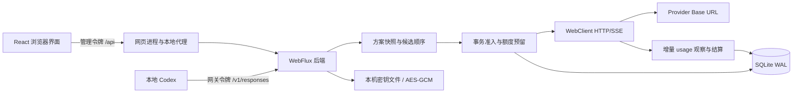
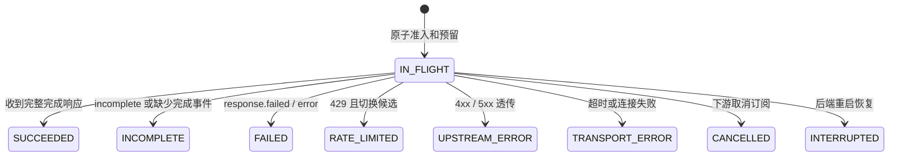

# 第一版架构与设计决策

## 1. 目标和边界

业务核心是「选择一个可用的 API Key 来源，为本地 Codex 转发一次 Responses 请求，并可信地结算本次请求的用量」。Provider、路由方案和使用记录互相独立，未来的会话管理、提示词管理以新领域模块加入。

本仓库是 Codex Squire 当前主线，独立实现 Provider 网关，没有直接复用其他实现的数据库结构。设计参考 Codex-Manager 的 service / web / desktop 职责划分，而不复刻其 OAuth、RPC 分发、多协议适配和桌面桥接复杂度。下列参考路径属于外部参考项目，不是本仓库文件。

参考项目的关键阅读入口：

- `docs/zh-CN/ARCHITECTURE.md`：运行形态、目录边界和发布关系。
- `crates/service/src/gateway/mod.rs` 与其 request、upstream、protocol_adapter 子模块：请求入口、传输与协议转换边界。
- `docs/zh-CN/report/当前网关与Codex请求头和参数差异表.md`：会话亲和、请求重写、上游头部等职责。
- `crates/service/tests/gateway_logs/`：故障转移、额度与日志的联动测试范围。

本版选择直接转发 Responses 原始请求体，不做工具名映射、模型替换或协议转换。这减少了兼容面，也意味着所有成员 Provider 必须支持请求中使用的模型和参数。

## 2. 部署结构

开发和本地使用时网页通过 Vite 同源代理访问后端，后端和网页都只监听回环地址。网关流量直接进入后端，不需要网页进程在线。

两个独立启动脚本共用根目录 `.env`，通过 `scripts/Environment.ps1` 校验配置。配置文件缺失或未填写时终止；端口冲突不自动递增。网页代理与后端 Origin 由同一组端口推导，网页启动时检查后端健康状态。环境文件是脚本层输入，Spring Boot/Vite 本身不会自动读取根文件，详见 [环境与运行配置](configuration.md)。

## 3. 模块和依赖方向

| 包 / 目录 | 职责 |
| --- | --- |
| `api` | 路由、DTO 校验、HTTP 状态和稳定错误结构 |
| `provider` | 来源实体、配置校验、密钥更新语义、持久化 |
| `scheme` | 方案聚合、成员顺序和权重、原子激活 |
| `gateway` | 路由候选、上游生命周期、原始数据流转发、增量解析 |
| `usage` | 原子准入、占额、幂等结算、统计和日志查询 |
| `security` | 管理/网关鉴权、Origin 约束、凭据加解密 |
| `persistence` | SQLite 连接配置、事务、进程锁、版本化迁移与版本检查 |
| `config` | 有界 JDBC 调度器与 UTC 时钟 |
| `frontend/src/features` | 按领域拆分的页面与编辑器 |
| `frontend/src/api.ts` | 类型化 API 客户端与统一异常映射 |

`api -> 业务组件 -> persistence` 为主要调用方向。实体与输入对象使用 record，服务采用构造器注入；record 本身不保证其集合成员深度不可变。当前 Provider/Scheme/Attempt Repository 也承担部分业务校验、准入与结算，并非严格独立的 Service/Repository 分层。后续随着规则复杂度提高拆出 AdmissionService、OutcomeResolver 等职责，不为单一实现创建空接口或万能 BaseService。

SQLite JDBC 是阻塞驱动，**不是伪装成 R2DBC**。所有请求期间的 JDBC 操作显式放在名为 `sqlite` 的有界调度器：4 线程，每线程最多排队 1024 项。WebFlux/Netty 负责网络 I/O 和流转发。短期阻塞事务只用于配置写入、准入和结算，不持有整个模型响应期间的数据库锁。

## 4. 数据模型

### Provider

包含名称、Base URL、加密 API Key、启用状态、每日请求上限、每日 Token 上限、最大并发、单次 Token 预留和创建时间。名称唯一；API Key 留空更新时保留旧值。Base URL 禁止用户信息、查询参数和 fragment，远程 HTTP 被拒绝。

### Scheme / Member

Scheme 包含策略和生效标记，成员列表是聚合的一部分。成员有显式 position 和 weight。一次保存完整替换成员列表，整个操作在同一事务中完成；失败时恢复原有方案。

SQLite 部分唯一索引约束 `active = 1` 的行最多一条。激活先撤销旧标记再设置新标记，均在一个写事务内。生效方案不可直接删除，空方案不可激活。被方案引用的 Provider 不可删除。

### Attempt

一行代表一次真实上游尝试。保存 request ID、attempt ID、Provider ID/名称快照、方案 ID、模型、开始/结束时间、状态、HTTP 状态、预留/结算 Token、缓存 Token、用量口径、耗时。

日志刻意不保存提示词、响应正文或凭据。Provider 删除不级联清除历史记录。`provider_id + day`、进行中请求、开始时间、网关请求 ID 建有索引。

统计以 attempt 为口径，不能等同于用户请求次数。失败后 429 切换的两个 Provider 各有自己的尝试记录，并共享网关 request ID。

## 5. 路由算法

1. 读取当前生效方案和成员快照。
2. 按序策略直接使用成员顺序。
3. 加权轮询使用单调递增序号对总权重取模，选择对应权重区间的成员作为首选，再旋转候选列表。
4. 依次尝试事务准入，跳过禁用、请求限额、Token 预算不足或并发满载的 Provider。
5. 发送一次上游请求。仅在明确的 429 拒绝且存在后续候选时继续；每个成员最多一次。
6. 返回已收到的上游状态/响应，或返回 `503 NO_AVAILABLE_PROVIDER`。

权重 2:1 的两个持续可用来源在每三个首选请求中分别获得 2 和 1 次。该策略平衡请求数量，不估测模型延迟、吞吐或金额；当前轮询序号是进程内状态，重启不保留。方案切换影响新请求，进行中的请求继续使用已选来源。

每次选择都会先按当前有效成员集隔离轮询序号；候选在原子准入失败后从剩余成员重新计算，因此禁用、额度耗尽和并发满载不会把失效权重转移给单一来源。所有状态仍是进程内调度状态，重启不保留。

默认不为 5xx 和连接异常自动重放，因为无法确认上游是否已经开始执行。失败次数不会被当作健康探测结果，也没有隐藏的付费周期探测。

## 6. 请求生命周期

通过 `Mono.usingWhen` 管理每次已准入尝试的完成、异常、取消清理。结算 SQL 只更新仍处于 `IN_FLIGHT` 的记录，因此重复清理不会重复记账。异步 JDBC 准入期间发生取消时，丢弃钩子负责释放已经落库的尝试。

上游 `ClientResponse` 的 body 在 `exchangeToMono` 回调内部消耗；不把响应对象带出其生命周期。上游完成后使用明确的 `Outcome.DELIVERED`，不依据 `Mono<Void>` 为空来判断成功或重试。

下游已提交之后的网络错误只能导致流结束或断开，不能重新构造一个普通 JSON 错误响应。实际 HTTP 状态可能已是 200；应结合日志中的最终状态检查。

每个 attempt 独立保存 `upstreamOutcome`、`deliveryOutcome` 和 `usageState`。因此 completed 后取消不会丢失上游执行结果，重定向、数据库和凭据错误也不会被统一伪装成上游失败。

## 7. SSE 与 Token 统计

网络转发不重编码 JSON、不拼接完整 SSE 流。每个 DataBuffer 的原始字节向下游转发，并即时 flush，以保持交互延迟和取消传播。

UsageInspector 只观察数据：

- 字节级识别 LF、CRLF 和 CR，允许一个 UTF-8 字符被拆到多个网络包。
- 在完整行后解码 UTF-8，支持一个事件多行 `data:`。
- 从 `response.completed`、`response.incomplete`、`response.failed` 的嵌套 `response.usage` 读取最终用量。
- 非流式读取顶层 `usage`；输入/输出必须为非负整数，缓存不得超过输入。
- 单个 SSE 事件观察上限 1 MiB；过大事件仍原样转发，但不解析，随后继续寻找终结事件。
- 非流式观察上限 8 MiB；不截断转发。解析不到可信 usage 时保留预留口径。
- 忽略 `[DONE]`、格式错误、负数和中间事件的临时 usage。

`REPORTED` 表示已经采集的上游报告值；`RESERVED` 表示缺少可信用量且未按拒绝归零，按配置保留占额；`NOT_APPLICABLE` 表示实现识别为 4xx 拒绝且没有已采集 usage，本地 Token 占额为零，不是供应商账单确认。普通透传分支优先采用已采集 usage；触发换源的 429 直接释放响应体，不会解析其中的 usage。

输入和输出窗口规则对 `RESERVED` 记录分别按本地占额保守计数，包括已结算但上游没有报告 usage 的尝试；`REPORTED` 记录使用真实分项。明确的 `response.incomplete` 表示上游协议正常完成一次受限生成，不触发 Provider 健康冷却；没有终态的响应仍计为协议异常。

## 8. 限额一致性

准入在 `BEGIN IMMEDIATE` 中查询当日请求和占额、所有日期的进行中数量，并插入预留记录。SQLite 的写锁使检查与占额不可被另一个写请求穿插。

`可准入 = enabled && inFlight < maxConcurrency && requests < requestLimit && charged + reservation <= tokenLimit`，其中 `0` 上限跳过对应检查。

结算不扣除请求次数；实际 usage 替换 charged_tokens。超出预留时如实结算而不是截断数字。取消/异常不自动丢弃已采集 usage；只有缺少可信用量且不能按已识别拒绝归零时才保留预留。状态与 usageState 必须分别解读。

此机制不能从远端预知最终 Token。它防止本地预留额度被并发超卖，但不保证上游账单绝不超过日预算；需要硬费用上限时，应同时使用来源服务商侧的硬限额。

## 9. 安全与运行边界

- 32 字节随机主密钥、管理令牌和网关令牌独立生成，不共享固定默认密钥。
- 上游 API Key 使用 AES-256-GCM，每次加密生成独立 12 字节 nonce。
- Linux/macOS 权限为目录 700、密钥 600；Windows 通过 ACL 限制为当前文件所有者并为数据目录设置继承。
- 两个不同令牌保护管理和代理接口；Origin 必须匹配显式本地允许列表。禁用基于 Cookie 的隐式鉴权。
- 后端仅监听 `127.0.0.1`，不跟随上游重定向，不透传入站 Authorization/Cookie。
- 网络连接超时固定 10 秒；上游读空闲超时与单次尝试总超时由共享配置设置，sample 为 120/1800 秒，不是整个多来源请求的共同 deadline；请求体最大 8 MiB。
- 每个数据目录有一个进程锁，防止两个后端同时恢复、结算同一份数据。所有连接设置 foreign_keys 和 busy_timeout，数据库启用 WAL。

密钥文件和数据库在同一用户权限边界内，加密不能保护已经能够读取整个目录的攻击者。此版本不是多用户 RBAC、远程认证网关或企业密钥托管系统。

备份时先停止后端，再备份整个数据目录，包括 `master.key`。仅备份 `squire.db` 无法解密来源密钥；运行中直接复制单个 DB 文件也可能遗漏 WAL。恢复时使用同一应用版本或兼容的后续版本。不要手动删除主密钥来“重置”来源。

当前数据库由版本化迁移器管理，并在 `schema_migrations` 中保存迁移 checksum；已有 V1 数据库会先安全 baseline，再执行后续增量迁移。V8 从旧 attempt 按 `request_id` 回填逻辑请求，并保留已有逻辑请求行；历史 `stream` 值无法恢复。Provider/Scheme 已有配置版本，更新必须通过 `If-Match`，冲突返回 412。新增持久化字段前仍必须补对应版本迁移和升级测试。已有加密凭据但主密钥缺失或无法解密时，后端会拒绝启动并要求从备份恢复；新密文带 `v1` 与 keyId，尚未实现密钥轮换和系统凭据库。

## 10. Tauri 与后续模块

未来 Tauri 只负责窗口、托盘、单实例、后端进程生命周期和受控的凭据获取。Java 后端继续拥有 Provider、路由、额度和 SQLite。当前管理接口和 Connection 组件都经过 ApiClient，但网关请求仍由 ApiClient 内部直接使用 Web `fetch`，尚未抽象可替换的 Web/Tauri transport。打包页面没有 Vite 代理，不能仅将 dist 放入 Tauri 就视为完成。

桌面打包前需要解决：JRE 裁剪或打包、Java 子进程退出回收、后端就绪握手、动态端口发现、Tauri origin/CSP、系统凭据库和升级迁移。本版没有声称这些已经实现。

会话管理应新增 session 领域并解决 response ID 到 Provider 的持久化绑定；提示词管理新增 prompt 领域，不依赖网关内部日志正文。日志归档、按时段统计和基于实际延迟的负载均衡可在保留现有 API 的前提下演进。

## 11. 协议依据与验证限制

目标协议为 OpenAI Responses API。官方入口：

- <https://developers.openai.com/codex/config-reference/>
- <https://platform.openai.com/docs/api-reference/responses-streaming/response/completed>

这些链接是协议参考入口，不表示已对最新远端文档逐条验证。当前配置字段和事件形态由实现及本地自动化测试支撑；官方页面访问与测试环境的历史限制记录在 [工程验证说明](engineering.md)。没有使用真实 Provider Key 调用付费 API，第三方来源兼容性仍需单独验证。当前问题与后续优先级以 [已知问题与开发顺序](known-issues.md) 为准。
