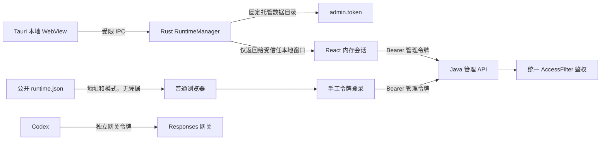
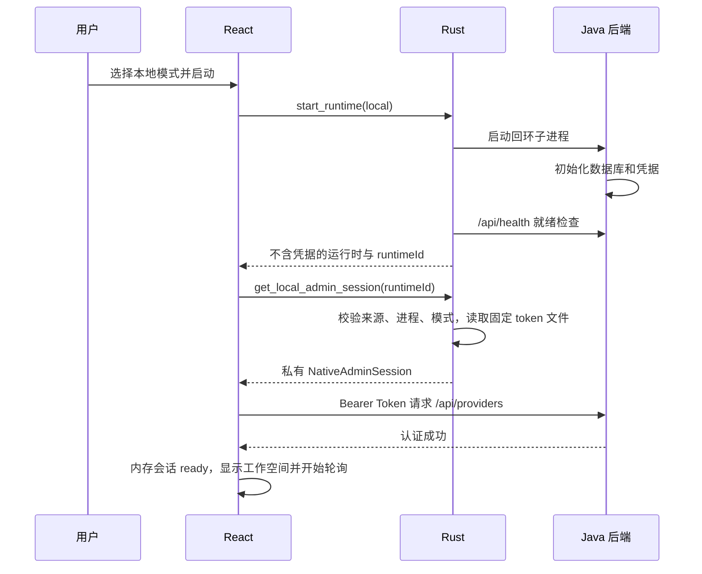

# Tauri 本地自动认证与浏览器令牌登录设计

日期：2026-10-10。

状态：本期方案已实现并纳入 `v0.2.3`。第 2 节保留最初调研快照，其后的契约是本期实现依据；当前行为与复现命令见 [桌面客户端架构](desktop.md)。一键修改 Codex 配置属于后续工作，未在本期实现。

## 1. 需求结论

可以在保留现有 Java 管理接口、Token 校验和数据模型的基础上实现需求。

推荐方案是：Tauri 本地窗口通过受限原生 IPC，读取自身托管后端使用的 `admin.token`，在前端内存中建立认证会话，再继续通过现有 `ApiClient` 请求后端。用户不需要输入 Token，但每个管理 HTTP 请求仍携带有效的 Bearer Token。

浏览器没有这项原生能力，必须通过管理令牌登录。访问地址是 `127.0.0.1`、`localhost` 或局域网 IP，都不会改变认证要求。

本方案按用户明确提到的“本地模式”限定自动认证范围：Tauri 内置窗口选择 `local` 时自动认证，选择 `service` 时维持手动令牌登录。将来若服务模式的内置窗口也需要自动认证，应作为独立需求调整原生策略；对外浏览器始终使用令牌。

### 1.1 本期必须完成

1. Tauri 本地模式启动成功后直接进入管理界面，不出现管理令牌输入框。
2. Tauri 本地页面刷新或重新加载后，能重新取得当前原生运行时并自动恢复认证。
3. 所有普通浏览器首次访问都需要输入管理令牌，包括访问本机 Vite 地址和本机服务模式静态前端。
4. 浏览器登录后保留当前标签页的会话，刷新时无需重复输入；退出、会话失效或更换后端时重新登录。
5. 后端 `/api/*` 继续鉴权，`/v1/responses` 继续只接受网关令牌。
6. 自动取得的管理令牌不进入公共运行时描述、浏览器存储、URL、日志或构建资源。
7. 后端退出、认证失败和异步竞态有明确状态，不能通过手工输入 Token 掩盖本地自动认证故障。
8. 修复现有跨域 `If-Match` 预检问题，保证桌面及服务网页面的配置编辑可用。

### 1.2 本期不包含

- 自动跳过本地/服务模式选择，或者开机自启。
- 修改 Codex 配置、写入系统环境变量、启动 Codex 或迁移 Codex 凭据。
- 为本地模式新增一个对外 HTTP 静态前端。
- 新建用户体系、OAuth、Cookie 登录、系统凭据库或管理会话服务端数据库。
- 改动 Provider 路由、网关令牌、额度账本和已有数据库迁移。
- 将所有管理请求改造成 Rust HTTP 代理。

## 2. 初始调研快照与改动依据

| 位置 | 当前行为 | 对本期的影响 |
| --- | --- | --- |
| `frontend/src/App.tsx` | 统一从 `sessionStorage` 读取 Token；只要 Token 为空就显示 `Login` | 缺少桌面自动认证入口和认证来源区分 |
| `frontend/src/runtime.ts` | 根据协议或 `__TAURI*` 判断桌面，保存公开运行时信息 | 环境检测只是前端提示，不能作为授予凭据的依据 |
| `src-tauri/src/lib.rs` | 管理自身 Java 子进程，知道数据目录、端口、运行模式，等待健康检查 | 已有实现自动认证所需的原生上下文 |
| `RuntimeDescriptor` | 返回地址和 `adminTokenPath`，没有 Token | 可以继续作为不含凭据的运行时契约 |
| `WebRuntimeDescriptor` | 静态服务器只序列化明确列出的公开字段 | 必须继续与凭据返回结构分离 |
| 服务模式的 `backendUrl` | 当前原生与浏览器共用用户公布的主机地址 | 原生请求应使用自身后端回环地址，避免与桌面 CSP 冲突 |
| `backend/.../LocalSecrets.java` | 初始化管理令牌，并在内存中校验 Bearer | 不需要增加免鉴权分支或 Token 导出 HTTP API |
| `backend/.../AccessFilter.java` | 校验 Token 和 Origin，CORS 只允许两个请求头 | 必须补充 `If-Match` |
| `src-tauri/build.rs` | 只调用默认 `tauri_build::build()` | 新敏感命令需要显式应用命令权限清单 |
| `src-tauri/capabilities/default.json` | 只给 `main` 配置 `core:default` | 不能把该权限当作所有自定义命令已受显式 ACL 管理的证据 |

当前 Tauri 本地模式没有 Rust 静态前端服务器，浏览器访问通常是开发 Vite 或另外配置的静态页面。本需求要求这些页面仍需登录，不意味着要增加一个新的浏览器入口。

上一轮已完成当前代码验证：48 项 Java 测试、Checkstyle、前端构建、17 项环境检查、5 项 Rust 测试、4 项 Playwright 测试通过。其中 Playwright 通过 Vite 同源代理访问 API，没有验证真实 Tauri 自动认证，也没有覆盖跨域 `If-Match`。

## 3. 启动、宿主和认证的独立维度

不能用一个 `isLocal` 同时表示“本机地址”“Tauri 宿主”“本地运行模式”和“已认证”。

| 维度 | 值 | 决策来源 |
| --- | --- | --- |
| 客户端宿主 `clientHost` | `browser` / `tauri` | 原生桥是否实际可用；前端标记仅用于选择检测路径 |
| 后端运行模式 `runtimeMode` | `local` / `service` | Rust 当前托管运行时；网页模式可由公开描述提供显示信息 |
| 认证来源 `authSource` | `manual-token` / `native-local` | 完成的手动校验或受限原生会话获取 |
| 运行实例 `runtimeId` | 不透明实例标识 | Rust 创建一次后端运行时后生成 |
| 前端会话代次 `sessionEpoch` | 单调递增数字 | 前端开始、结束、切换或恢复一次会话时更新 |

`runtimeId` 和 `sessionEpoch` 都不是秘密，也不能用于后端鉴权。前者区分启动实例，后者拒绝过期异步结果。

### 3.1 行为矩阵

| 客户端 | 运行模式/地址 | 首次访问 | 页面刷新 | 退出行为 |
| --- | --- | --- | --- | --- |
| Tauri 内置窗口 | `local` | 原生自动认证 | IPC 查询运行时后重新认证 | 隐藏“退出管理”；关闭应用继续执行既有退出回收 |
| Tauri 内置窗口 | `service` | 管理令牌登录 | 对同一后端校验手动会话 | 清理手动会话并返回登录页，服务继续运行 |
| Chrome/Edge 等 | Vite `127.0.0.1` 或 `localhost` | 管理令牌登录 | 校验标签页手动会话 | 清理会话，后端继续运行 |
| Chrome/Edge 等 | 服务前端的本机地址 | 管理令牌登录 | 校验标签页手动会话 | 同上 |
| Chrome/Edge 等 | 服务前端的局域网地址 | 管理令牌登录 | 校验标签页手动会话 | 同上 |
| 任意 HTTP 客户端 | 直接调用 `/api/*` | 必须携带有效管理令牌 | 不适用 | 不适用 |

健康检查和允许的 CORS 预检继续采用现有例外。浏览器 Origin 不被允许时返回 403；“需要 Token”不代表任何网页 Origin 都自动获得访问资格。

同一份 Vite 页面在 Tauri 开发 WebView 内可以使用原生自动认证，在普通浏览器中仍需要令牌。差异来自受限 IPC，而不是页面 URL。

## 4. 方案选择

| 方案 | 特点 | 结论 |
| --- | --- | --- |
| 后端按回环地址或 Origin 免鉴权 | 改动少，但无法可靠区分浏览器、CLI 和 Tauri；本机网页也能触达后端 | 不满足需求 |
| 公共运行时 JSON 返回 Token | 浏览器也会获得凭据，失去登录边界 | 不满足需求 |
| JavaScript 全局变量、URL 参数或静态脚本注入 Token | 容易进入持久化、调试输出或公共资源，刷新与生命周期难管理 | 不采用 |
| 受限原生 IPC 返回管理 Token，前端只保存在内存 | 复用现有 API 和 Token 模型，改动集中，支持刷新恢复 | 本期推荐 |
| 所有管理请求通过 Rust 转发，令牌只留原生内存 | 缩小 WebView 中的凭据暴露，但要实现完整 HTTP、超时、取消、错误和响应契约 | 作为未来加强方案 |
| 后端新增临时桌面会话及换票协议 | 可实现过期、撤销和作用域，但需要额外凭据与生命周期 | 当前范围没有必要 |

推荐方案的安全承诺是防止普通浏览器自动获取令牌，不是隔离同一操作系统用户下的所有恶意进程。具有数据目录读取权限的进程本来就能读取令牌；受信任 WebView 发生脚本注入时也可能接触内存令牌。需继续控制原生权限、导航和 CSP，不把内存存储描述成完整的秘密隔离。

## 5. 目标架构



Java 不需要识别请求来自哪种客户端：它继续只验证管理令牌或网关令牌。免输入体验由 Rust 和 React 协作提供。

### 5.1 Rust 的职责

- 保存当前托管运行时的真实模式、数据目录、后端地址和运行实例标识。
- 校验 IPC 调用者是被允许的应用窗口和页面。
- 只为仍在运行的 `local` 子进程提供自动认证凭据。
- 从内部保存的固定目录读取 `admin.token`，不给 JavaScript 通用文件读取能力。
- 返回结构化、安全的错误，不把令牌内容放进 Debug 或日志。

### 5.2 React 的职责

- 在启动解析完成后选择自动认证或手动登录流程。
- 本地自动认证成功前不执行后台管理轮询。
- 将自动凭据限制在当前内存会话和 `ApiClient` 实例中。
- 查询后端验证令牌，拒绝把“IPC 返回成功”直接等同于后端认证成功。
- 使用会话代次隔离刷新、启动、401、重试和取消的异步结果。
- 根据认证来源提供正确的界面和退出行为。

### 5.3 Java 的职责

- 保持既有 Bearer 校验、Token 隔离和 Origin 策略。
- 允许跨域配置更新所需的 `If-Match`。
- 不新增 `/api/local-login`、`/api/admin-token` 或本机请求免鉴权开关。

## 6. 原生契约与凭据生命周期

### 6.1 公开运行时与私有运行时

`RuntimeDescriptor` 增加 `runtimeId`，保留已有地址和模式字段；`runtime_status`、`start_runtime` 仍不返回凭据。

`RunningRuntime` 内部保存以下字段，名称可按现有风格调整：

```rust
struct RunningRuntime {
    descriptor: RuntimeDescriptor,
    data_directory: PathBuf,
    backend: Child,
    static_server: Option<StaticServerHandle>,
}
```

`data_directory` 是启动 Java 时实际使用的绝对目录，不能在凭据请求时重新读取环境变量，也不能从前端回传的 `adminTokenPath` 推导。

启动时还要区分两种后端地址：

| 地址 | 生成方式 | 使用方 |
| --- | --- | --- |
| 原生管理连接地址 | `http://127.0.0.1:<backendPort>`，由实际端口构造 | Tauri 内置窗口的 `backendUrl`，包括 service 模式的手动登录 |
| 公布后端地址 | local 使用回环地址；service 使用校验后的 advertisedHost | 浏览器公开描述的 `backendUrl`、网关公布地址和 Java 的 `SQUIRE_PUBLIC_BASE_URL` |

当前 service 模式的 Rust descriptor 将公布地址直接用作原生 `backendUrl`，而桌面 CSP 主要允许回环连接。改为面向调用方分别构造地址后，原生管理请求不会需要放宽任意局域网 CSP，浏览器也不会错误地连接浏览器自己机器的回环地址。

`RuntimeDescriptor.backendUrl` 表示原生客户端连接地址，`gatewayUrl` 仍表示公布的网关地址。构造 `WebRuntimeDescriptor` 时显式传入公布后端地址，不能继续直接复制原生 `backendUrl`。地址分离不影响 Java 实际 bind address，也不改变浏览器的 Token 要求。

`runtimeId` 每次创建新的 Java 子进程时生成，重复获取同一运行实例时不变化。可使用当前进程生命周期内的启动序号和进程标识；无需为鉴权引入新的随机秘密或数据库字段。

`WebRuntimeDescriptor` 继续通过单独结构明确列出公开字段。可以包含非秘密的 `runtimeId`，但不包含 `adminTokenPath`、管理 Token、网关 Token、内部数据目录或原生认证策略。不要使用一个通用结构加条件隐藏凭据。

### 6.2 新增 IPC 命令

命令名：`get_local_admin_session`。

输入只有期望的运行实例标识，用于拒绝启动切换后的旧请求：

```ts
interface LocalAdminSessionRequest {
  expectedRuntimeId: string;
}

interface NativeAdminSession {
  runtimeId: string;
  backendUrl: string;
  adminToken: string;
}
```

不接受任意路径、目录、URL、端口、窗口标签、运行模式或 Token 文件名。调用窗口由 Tauri 注入的原生 WebView/Window 上下文获得，不能相信 JavaScript 参数。

该结构只作为专用 IPC 返回值，不能嵌入公开运行时、赋值给 `window.__SQUIRE_RUNTIME__`、发送事件广播或写入浏览器存储。

### 6.3 原生执行步骤

1. 从原生上下文校验调用窗口和来源，随后进入运行时锁。
2. 确认 `running` 存在，且 `backend.try_wait()` 表示子进程仍存活。
3. 比对 `expectedRuntimeId` 与当前实例。
4. 检查内部真实模式是 `RuntimeMode::Local`，地址是启动器生成的回环后端地址。
5. 从内部 `data_directory.join("admin.token")` 读取内容。
6. 限制最大读取量，例如 4 KiB；只接受可用于 Bearer 头的可打印 ASCII，拒绝读取失败、非 UTF-8、空值、内部空白和换行。允许去掉文件首尾空白，以兼容既有文件写法，不强制既有 Token 必须是新生成值的固定长度。
7. 再确认实例与进程状态，然后返回当前实例、地址和令牌。

读取失败不创建、重置或改写令牌文件；凭据生命周期仍由 Java `LocalSecrets` 管理。读取是短操作，不在持锁期间做长网络请求或循环等待。

Rust 返回后进程仍可能退出，因此前端还要验证后端并处理失败。该检查不是防御恶意本机进程冒充端口的完整密码学握手；当前同用户本机威胁范围不扩大为这种承诺。

### 6.4 错误契约

| code | 含义 | 前端处理 |
| --- | --- | --- |
| `NATIVE_ACCESS_DENIED` | 调用者窗口或页面不受信任 | 显示初始化错误，不进入自动认证 |
| `RUNTIME_NOT_RUNNING` | 运行时不存在或子进程已退出 | 清理会话并回到启动器 |
| `RUNTIME_CHANGED` | 请求对应旧启动实例 | 丢弃旧结果，查询当前运行时 |
| `LOCAL_AUTH_UNAVAILABLE` | 当前是服务模式 | 转入手动登录流程，不能偷偷获取本地令牌 |
| `ADMIN_TOKEN_READ_FAILED` | 文件读取失败 | 本地认证错误，提供重试 |
| `ADMIN_TOKEN_INVALID` | 内容格式不适合 Bearer 头 | 本地认证错误，提示检查运行时 |
| `LOCAL_AUTH_REJECTED` | HTTP 校验返回 401 | 清理自动会话，有限恢复后显示错误 |

新命令错误使用 `{ code, message }`；既有命令的字符串错误兼容保留。前端 `runtimeErrorMessage` 应先处理该结构，并保留旧错误格式支持。

消息和错误日志不得包含文件内容、完整请求头或整个 `NativeAdminSession`。包含令牌的 Rust 结构不派生会输出所有字段的 `Debug`。

## 7. 原生权限与网络边界

### 7.1 应用命令 ACL

本机锁定版本的 Tauri 源码显示：远端来源会检查权限；应用提供自己的 ACL manifest 后，自定义命令也会进入显式授权流程。现有 `core:default` 是核心插件权限，不能代替新凭据命令的应用权限。

开发时使用已确认可用的 `tauri_build::AppManifest::commands` 声明以下命令：

- `start_runtime`
- `stop_runtime`
- `runtime_status`
- `runtime_port_settings`
- `get_local_admin_session`

构建生成对应的 allow/deny permission，再在 `main` 的 capability 中只允许所需命令。添加 manifest 时必须同时授权原有命令，包括 v0.2.2 新增的端口设置读取，避免已有启动器被拒绝。

capability 明确限制本地内容和 `main` 窗口，不增加远程 URL 的凭据访问权限，不加入通用 filesystem 或 shell 插件授权。具体 permission identifier 以锁定构建生成的 schema 为准，不凭字符串命名猜测。

### 7.2 来源检查和导航

原生凭据命令还要校验 `main` 调用窗口及当前页面 URL：

- 正式包只接受实际应用资源来源，如 Windows 当前配置的 `http://tauri.localhost`，或其他平台对应的应用协议。
- 开发构建额外接受配置中精确的 `devUrl` 来源。
- 使用 URL 解析后的 scheme、host、port 比较，不能通过字符串前缀或“任意 localhost 端口”放行。
- 不通过 HTTP `Origin` 或前端自报的 `isDesktopApp` 决定返回凭据。

为 `main` 安装同样的导航限制，拒绝在拥有原生权限的窗口内加载外部页面。现有配置自动创建窗口；如果需要通过 `WebviewWindowBuilder::on_navigation` 注册限制，可将窗口改为在 setup 中按原配置创建，保留尺寸、标题和其他设置。该改动必须验证开发 HMR、hash 导航和正式资源加载。

### 7.3 CORS 和 CSP

`AccessFilter` 的 `Access-Control-Allow-Headers` 必须增加 `If-Match`。原有 Token 校验、允许方法和 Origin 判断继续生效。当前前端从 JSON 中读取版本，不依赖 JavaScript 读取 ETag，因此暴露 ETag 不是本期前提。

Tauri 本地后端的允许 Origin 应包含实际受信任应用来源；开发时增加精确的 `devUrl` 来源。仅有现在的 `tauri://localhost,http://tauri.localhost` 不足以支持通过 Vite 来源运行的开发 WebView。

开发 Origin 被允许后，同 URL 的普通浏览器仍必须携带有效 Token。CORS 允许跨域请求，不授予认证身份。

本地模式不使用 `*` Origin。服务模式既有显式广播行为继续维持其受信任局域网边界，本期不改造成公网部署。

前端管理 fetch 使用 `redirect: "error"`，自动凭据只能发送给原生返回的准确后端地址；不从查询参数或全局变量覆盖该地址。CSP 的来源应与真实运行方式匹配，不为方便自动登录放宽任意远端连接。

## 8. 前端会话设计

### 8.1 结构

建议增加 `frontend/src/auth.ts` 表达认证策略、会话类型和手动会话存储规则；增加一个 `useWorkspaceSession` hook 管理生命周期。`runtime.ts` 保留环境发现和 IPC 封装，`ApiClient` 保留 HTTP 和领域 API。避免继续向 `App.tsx` 添加多个互相依赖的布尔值。

会话按状态使用可辨识联合类型：

```ts
type WorkspaceSession =
  | { status: 'discovering' }
  | { status: 'stopped'; clientHost: 'tauri' }
  | { status: 'starting'; clientHost: 'tauri'; sessionEpoch: number }
  | { status: 'authenticating'; clientHost: ClientHost; runtime: RuntimeInfo; sessionEpoch: number }
  | { status: 'login-required'; clientHost: ClientHost; runtime: RuntimeInfo }
  | { status: 'ready'; clientHost: ClientHost; runtime: RuntimeInfo;
      authSource: AuthSource; token: string; sessionEpoch: number }
  | { status: 'fault'; clientHost: ClientHost; runtime?: RuntimeInfo;
      code: string; message: string };
```

这里只规定设计形状，最终类型还需覆盖 Vite 相对 API 地址，不要求网页一定存在 runtime 描述。`RuntimeInfo` 的普通网页字段与桌面专用字段分开，浏览器不依赖 `adminTokenPath`。

### 8.2 决策原则

- 在运行时发现完成前，不读取并使用旧 Token 发出后台管理请求。
- `isDesktopApp()` 只是检测线索；桌面运行时必须通过真实 IPC 查询。
- `window.__SQUIRE_RUNTIME__` 最多作为显示或启动提示，不能用于取得自动身份。
- 网页发现的 `mode: "local"`、`runtimeId` 或 `autoLogin` 字段不能使网页跳过登录。
- 公共运行时需要校验合法 mode、HTTP(S) URL 和必要字段；不能仅做 TypeScript 类型断言。
- 浏览器发现失败时按现有 Vite 相对路径运行，进入手动登录。
- 原生桥异常时显示桌面初始化故障；不静默改连另一个后端。

### 8.3 自动凭据的保存

`native-local` Token 只存在于当前 React 会话和对应 `ApiClient` 中，不写入 `sessionStorage`、`localStorage`、IndexedDB 或全局运行时对象。清理会话会停止引用这些值，但 JavaScript 不提供可保证的内存安全擦除。

进入桌面本地流程时忽略手动登录的旧存储值，不能让它抢先发起 HTTP 请求。旧的无后端归属 `squire.adminToken` 键可以清除。

`manual-token` 继续使用标签页 `sessionStorage`，但增加后端归属：键或记录至少绑定规范化后的 API base URL；Vite 代理绑定当前页面 Origin。发现后端后才读取该范围内的 Token，校验成功后进入 ready。

旧无归属存储不自动迁移到任意后端；升级后最多要求一次重新登录。不使用永久 localStorage，也不引入跨窗口共享登录。

### 8.4 ApiClient 与错误通知

保留 `new ApiClient(token, baseUrl)` 的主要形式，可以增加受限的 `onUnauthorized` 回调或统一的认证错误通知，供会话 hook 处理。所有管理请求都使用相同的 401 处理规则，而不是只有全局 refresh 才清理登录。

回调必须绑定创建客户端时的 `sessionEpoch`；旧客户端的 401 不能清理新会话。首次登录验证的 401 显示在登录表单，本地自动认证校验的 401 进入本地故障流程。

网关测试仍使用独立 gateway Token。`/v1/responses` 返回 401 不触发管理会话失效，也不自动换用 admin Token。

不需要本期抽象通用 HTTP transport。以后若选择 Rust 代理，再在 `ApiClient` 内部增加对应 transport，实现响应、取消、超时与错误等价性。

## 9. 完整操作流程

### 9.1 Tauri 首次启动本地模式



保留用户选择模式的启动器。认证期间显示“正在连接本地工作空间”，不显示 Token 输入框。验证请求 `/api/providers` 不涉及付费上游，可复用其结果，或者在首次全量刷新中完成同等验证。

### 9.2 Tauri 页面刷新

1. 页面重新进入 discovering。
2. 调用 `runtime_status`，取得当前运行实例，不依赖 JavaScript 全局变量仍然存在。
3. 若运行实例是 local，重新执行原生认证。
4. 若运行实例是 service，进入手动会话恢复或登录。
5. 若运行实例不存在，回到启动器。

刷新不能启动第二个 Java 后端。StrictMode、HMR 或重复 effect 触发时，同一实例的认证请求要合并，且旧 effect 的返回值不能覆盖当前状态。

### 9.3 普通浏览器

1. 读取公开运行时，或回退到 Vite 相对 API 路径。
2. 解析并固定本次后端地址。
3. 有该后端对应的标签页手动会话时先校验；否则显示登录页。
4. 用户输入管理令牌，后端校验成功后保存手动会话。
5. 开始全局轮询和管理操作。

原生应用同时运行、网页地址是回环地址、公共描述是 local，都不会改变这条流程。

### 9.4 退出和停止

- 浏览器和 Tauri service 继续显示“退出管理”，清理手动会话和页面数据，后端不停止。
- Tauri local 隐藏手动退出按钮；否则会出现退出后立刻自动登录，或重新出现 Token 输入页的矛盾。
- 本期不把“退出管理”偷偷替换为“停止后端”，避免中断正在使用网关的 Codex。
- 应用关闭继续走既有原生回收。已有 `stop_runtime` 被调用后，前端清理自动会话并回到启动器。
- 本期不增加复杂的运行模式热切换。若后续暴露模式切换，应显式停止旧运行实例后重新启动，不能依赖当前 `start` 返回既有实例的行为完成切换。

## 10. 失败处理与竞态约束

| 场景 | 处理 |
| --- | --- |
| Java 启动失败或实例锁冲突 | 沿用启动器故障信息，不尝试读取或展示 Token |
| Token 文件缺失或无法读取 | 停留本地认证故障页，提供重试，保留当前原生运行时 |
| IPC 取得 Token 后后端已退出 | 请求失败，查询运行状态；已停止则回启动器 |
| 401，原生运行实例仍存在 | 单次合并重新取凭据并验证；仍为 401 则显示错误，不无限循环 |
| 其他网络错误、403、数据库错误 | 显示对应连接或配置错误，不把它统一当作 Token 失效 |
| 手工修改 token 文件，但 Java 仍持有旧值 | 重取也可能无效，提示重启运行时；不自动改写文件 |
| 获取凭据时实例已切换 | `RUNTIME_CHANGED`，丢弃结果并按新实例重建会话 |
| 旧轮询返回或旧请求报 401 | epoch 不匹配即丢弃，不能更新或退出新会话 |
| 页面卸载时 IPC 仍运行 | IPC 未必支持 AbortSignal，使用存活标记与 epoch 拒绝晚到结果 |
| 自动认证重试中的配置 POST/PUT/DELETE | 不自动重放，用户重新发起操作 |
| 网关测试返回 401 | 仅显示网关凭据错误，不清除管理认证 |

自动恢复只恢复身份和只读数据获取。对于可能已经执行的修改请求，不因重新取得令牌而隐式再发送一次。

### 10.1 会话结束时统一清理

1. 增加 `sessionEpoch`，立即使旧异步结果失效。
2. 取消全局刷新、请求列表读取和正在执行的可取消测试。
3. 停止属于旧会话的轮询和后端状态监听。
4. 清理对应 Token 引用、API 实例、统计、Provider/Scheme 数据和连接页网关凭据。
5. 根据来源进入登录页、启动器或本地认证故障页。

短暂网络故障不结束会话，沿用当前编辑草稿；运行实例变更或真正退出时不复用旧草稿向新后端提交。Provider API Key 不应为保存草稿而进入持久化。

## 11. 开发拆解

### 阶段 A：原生身份和权限

| 文件 | 计划改动 |
| --- | --- |
| `src-tauri/src/lib.rs` | RunningRuntime 保存真实数据目录和 runtimeId；区分原生回环连接与浏览器公布地址；实现固定路径 Token 读取及结构化错误；增加受限 IPC |
| `src-tauri/build.rs` | 声明应用命令 manifest，生成显式 allow/deny permissions |
| `src-tauri/capabilities/default.json` | 对 main、本地内容授权四个应用命令；不给远端内容敏感权限 |
| `src-tauri/tauri.conf.json` | 按需要调整窗口创建及导航限制，验证现有 CSP 和开发来源 |
| `src-tauri/src/lib.rs` 测试模块 | 增加 Token 读取、模式、实例和公开序列化测试 |

完成标准：受信任 main 可以获得自身 local 会话；service、停止实例、其他窗口、远端页面及错误实例全部被拒绝；公开 JSON 没有凭据。

### 阶段 B：前端会话和启动流程

| 文件 | 计划改动 |
| --- | --- |
| `frontend/src/runtime.ts` | 新 IPC 类型和调用；原生运行时恢复；结构化错误和公开描述校验 |
| `frontend/src/auth.ts` | 会话类型、认证来源、手动存储范围和策略 |
| `frontend/src/hooks/useWorkspaceSession.ts` | 启动发现、自动认证、手动认证、epoch、恢复和清理 |
| `frontend/src/App.tsx` | 使用会话状态呈现 Launcher/Login/认证中/故障/工作空间；只在 ready 后轮询 |
| `frontend/src/api.ts` | 管理 401 通知与 redirect 策略，保持网关认证独立 |
| `frontend/src/features/Launcher.tsx` | 启动结果接入会话流程，启动/认证状态与失败可见 |
| `frontend/src/components.tsx` 或认证错误组件 | 展示本地连接故障和重试，不暴露凭据 |

可优先使用现有 Playwright 验证可辨识状态与异步行为，避免为了少量纯函数强行引入庞大的测试框架。若需要直接测试 reducer/存储策略，可使用最小测试入口。

完成标准：local 启动和刷新自动进入工作空间；浏览器以及 service 保持手动登录；晚到结果、401 和重试不会串用会话。

### 阶段 C：跨域闭环

| 文件 | 计划改动 |
| --- | --- |
| `backend/.../security/AccessFilter.java` | CORS allow headers 增加 If-Match，保留 Token 校验 |
| `backend/src/test/java/dev/squire/GatewayIntegrationTest.java` | 预检、回环无 Token、Token 隔离和开发 Origin 回归 |
| `frontend/tests/workspace.spec.ts` 或独立认证 spec | 浏览器登录、伪造描述、跨域编辑、桌面状态模拟与恢复 |
| `docs/desktop.md`、`docs/api.md`、`docs/engineering.md`、README | 更新已实现行为、认证差异与真实验证边界 |

完成标准：跨域编辑可以保存，普通浏览器和直接 HTTP 请求仍需管理 Token。CORS 修改是这一功能闭环的一部分，应与前端状态改动同时交付。

### 阶段 D：真实桌面验收

构建真实桌面程序，在独立测试数据目录下检查开发 WebView 和正式资源 WebView。本期无需建立新的远程服务或大型桌面自动化设施，但必须有真实窗口验收记录。

Playwright 中模拟 `__TAURI_INTERNALS__.invoke` 只能验证 React 状态，不能证明 Tauri ACL、原生令牌读取或正式包来源正确。不能将模拟测试结果表述成真实桌面安全边界验收。

本期预计主要改动在 Rust 和前端会话，Java 只有跨域请求头与测试；不增加数据库迁移，不要求新增生产 HTTP 依赖。

## 12. 测试与验收矩阵

### 12.1 Rust 与原生能力

| 用例 | 预期 |
| --- | --- |
| 本地实例、main、受信任来源、正确 runtimeId | 返回固定目录的有效 Token |
| service 实例请求自动会话 | `LOCAL_AUTH_UNAVAILABLE` |
| 无实例、后端已退出 | 不返回凭据 |
| 旧 runtimeId | `RUNTIME_CHANGED` |
| 非 main 窗口或远端页面 | 由 ACL/原生守卫拒绝 |
| Token 空、超长、内部换行、非 UTF-8、读取失败 | 安全错误，内容不出现在消息中 |
| 当前环境变量在启动后变化 | 仍只读取原实例使用的数据目录 |
| runtime_status / start_runtime / runtime.json 序列化 | 不含管理或网关 Token，公共 JSON 不含私有路径 |
| 添加 manifest 后已有三个命令 | 仍可正常启动、查询、停止 |
| service 公布局域网地址 | 原生 descriptor 的管理地址仍为回环；公开网页 descriptor 使用公布地址 |
| 应用资源导航、hash 导航、HMR | 正常；远端导航被拒绝 |

### 12.2 后端与浏览器边界

| 用例 | 预期 |
| --- | --- |
| 127.0.0.1 无 Token 请求管理 API | 401 |
| 允许的 Tauri/开发 Origin 无 Token | 401 |
| 伪造自称 desktop/local 的请求头 | 无效，仍需 Token |
| 网关 Token 访问管理接口 | 401 |
| 管理 Token 访问网关 | 401 |
| 非允许 Origin | 403 |
| PUT 预检申请 Authorization、Content-Type、If-Match | 明确允许对应头，真实浏览器可发起请求 |
| 跨域 Provider/Scheme 更新 | 正确版本保存；旧版本仍返回 412 |
| 网页读取公开运行时或静态资源 | 不含任何登录秘密 |

### 12.3 React 与生命周期

| 用例 | 预期 |
| --- | --- |
| Tauri local 首次启动 | 不出现 Login；认证中之后进入概览 |
| 同一页面运行在普通 Chrome/Edge | Login，不能自动取得 Token |
| 浏览器描述自报 mode=local 或含 autoLogin 字段 | 仍需手动登录 |
| 浏览器伪造全局运行时对象 | 不产生后端有效身份，不能跳过认证校验 |
| local 自动认证 | sessionStorage/localStorage 无自动 Token |
| 刷新 Tauri 页面，清空 JavaScript 全局状态 | runtime_status 恢复，同一 Java 进程仍运行 |
| StrictMode/HMR 重复发现 | 认证合并，不重复启动 Java，不被旧结果覆盖 |
| 首次认证返回 401 | 有限重取后显示本地错误，无 Token 输入框 |
| 配置修改返回 401 | 会话处理正确，修改不自动重放 |
| 旧轮询 401 到达新 ready 会话 | 新会话不受影响 |
| 桌面后端退出或 stop_runtime | 凭据及旧数据清理，回到启动器 |
| 手动登录后刷新/退出 | 刷新验证恢复，退出重新显示 Login |
| 后端地址变化 | 不自动向新地址发送旧 Token |
| 网关测试 401 | 管理登录保持有效 |

### 12.4 真实桌面操作清单

1. 使用全新独立数据目录启动正式程序，选择 local，不读取令牌文件、不输入 Token，进入概览。
2. 创建和编辑 Provider/Scheme，验证 If-Match 跨域保存；使用模拟上游，不调用付费 API。
3. 在同一数据目录和同一运行实例下刷新 WebView，确认恢复认证且没有重复 Java 进程。
4. 在普通浏览器打开可用网页入口，确认必须输入 Token；浏览器无令牌调用相同后端返回 401。
5. 关闭 Java 子进程，确认自动凭据清理并显示启动器。
6. 重新启动 local，确认使用新 runtimeId 和新地址，没有旧请求覆盖新页面。
7. 选择 service 并公布局域网 IP，内置窗口通过回环地址正常手动登录，普通浏览器通过公布地址登录；本机浏览器也不例外。
8. 尝试远端导航及非 main 调用，确认不能取得原生凭据。
9. 关闭应用，确认既有进程回收仍有效。

## 13. 后续一键修改 Codex 配置的扩展设计

本节只规定下一期职责和前置条件，本期不实现命令、写文件、添加按钮或填充不可用的占位功能。

### 13.1 能力归属

一键修改本机 Codex 配置属于 Rust 的本地集成模块，例如未来的 `src-tauri/src/codex_config.rs`。Java 管理 API 不提供写任意客户端文件的接口，浏览器不获得文件写入能力。

下一期能力的条件至少是：受信任 main 窗口、真实 local 运行实例、认证和运行实例匹配。不能仅在 React 里隐藏按钮，原生命令本身也要拒绝 service 和远端调用。

本期建立的 clientHost、runtimeMode、runtimeId 和受限 ACL 可以复用，但“成功取得管理 Token”本身不等于已授权写 Codex 配置。

### 13.2 配置操作契约

建议下一期采用先预览再应用：

1. 原生解析实际用户配置路径，核实 Codex 配置目录约定以及用户是否使用自定义配置目录。
2. 使用支持保留注释和格式的 TOML parser/editor，不做正则替换或覆盖整个文件。
3. 生成目标变更，只调整 Squire provider 项和明确需要切换的配置，不覆盖模型、其他 provider 或用户自定义项。
4. 返回变更预览、目标路径、原文件摘要和冲突说明，不包含明文管理 Token。
5. 用户执行应用时比对摘要，拒绝预览后发生的外部修改。
6. 创建备份，使用同目录临时文件和 Windows 适配的原子替换；保留适当权限。
7. 重新解析和验证结果，并提供恢复备份的能力。

具体 TOML 字段、凭据引用方式及 Codex 配置目录规则必须在下一期按当时正式配置文档确认，不把当前示例写死为永远兼容的规范。

### 13.3 动态端口问题

初始设计快照中的 local 每次启动动态选择后端端口。当前 v0.2.2 已改为可配置的稳定端口，默认 `18787`，启动成功后保存、冲突报错。因此稳定入口的基础条件已具备，但用户修改端口后，既有 Codex 配置仍可能失效；免输入 Token 不会自动同步配置。

下一期应评估并选择以下策略之一：

- 为本地网关引入稳定端口，端口占用时明确报错，不静默切换。
- 维持动态端口，在每次启动时通过已授权规则更新应用管理的配置，并处理并发和用户修改。
- 引入稳定入口或托管 Codex 启动流程，由原生传入当前地址。

推荐优先评估稳定本地网关入口，因为它减少对用户配置反复写入；选型前仍要核实端口冲突、多工作空间和已有 Codex 使用方式。

### 13.4 网关令牌与环境变量问题

当前配置片段使用 `env_key = "SQUIRE_GATEWAY_KEY"`。仅修改 config.toml 不会让已经运行的 Codex 或父终端得到该环境变量。

下一期必须明确令牌供给方式：原生托管 Codex 启动、兼容的安全凭据引用，或用户认可的环境配置。写入 Windows 用户环境也不会自动更新现有进程，且扩大了凭据持久化范围。

给 Codex 的应是 gateway Token，绝不能把 admin Token 写进 Codex 配置。完整验收应包含真实 Codex 进程、应用重启、令牌变化和恢复，而不只是验证文件生成成功。

## 14. 兼容性与交付边界

- 现有 `admin.token`、`gateway.token`、Provider 密文及 SQLite 数据继续使用，不因自动登录重生成。
- 正常网页登录和现有领域 API 继续工作；旧无归属标签页会话可能需要一次重新登录。
- start/status 的新增实例字段应同步更新 Rust 与 TypeScript；网页发现允许识别没有实例字段的旧公开描述，但不会因此启用自动认证。
- 本地自动认证没有独立的服务端注销或吊销语义；清理前端内存不会吊销磁盘上的管理令牌。未来若需要这种能力，再设计会话令牌和撤销协议。
- 开发和正式包必须分别验收。开发服务器代码是受信任输入，不能把“来自本机端口”视为所有内容都安全。
- 本期不做真实供应商探测，不读取其他应用秘密，不修改用户 Codex 配置，不执行新部署或发布。

最终交付应包含代码、测试、更新后的行为文档，以及真实桌面模式矩阵的验证记录。已有网页 E2E 全部通过不是本期完成的唯一标准。

## 15. 实施顺序与完成定义

推荐依次实施：原生固定目录与实例契约 -> 显式 IPC 权限及来源限制 -> 前端会话状态与内存自动认证 -> 跨域编辑修复 -> 浏览器和生命周期回归 -> 真实桌面验收 -> 文档同步。

完成时必须同时成立：

1. 正式 Tauri local 从启动到进入工作空间全过程不要求手工 Token。
2. 刷新后自动恢复，不重复启动 Java，不复用错误实例凭据。
3. 普通浏览器在本机和局域网都必须通过 Token 登录。
4. 无 Token HTTP 请求仍被后端拒绝，管理/网关令牌仍相互隔离。
5. 公共资源、浏览器存储和日志没有自动凭据。
6. 所有管理操作的 401 行为一致，修改请求不会隐式重放。
7. 跨域 Provider/Scheme 编辑及版本冲突保护可用。
8. 原生敏感命令的 main、来源、模式和实例限制有验证证据。
9. 本期没有改写 Codex 文件；后续能力已有明确的原生职责和前置问题。

## 源码入口

本期开发的验证结果记录在 [工程验证记录](engineering.md#验证记录)。当前原生权限是显式的 5 个应用命令，包括端口设置读取；自动凭据仅保存在 `ApiClient` 内存。前端暂时性恢复校验失败会保留已有手动存储值以供重试，401 才清理该会话。后端 `If-Match` 修复已由 v0.2.2 主线提供，本分支保留并在真实 WebView 中复验。

- [前端应用和登录](../frontend/src/App.tsx)
- [认证策略与标签页存储](../frontend/src/auth.ts)
- [工作空间会话生命周期](../frontend/src/useWorkspaceSession.ts)
- [运行时发现与 IPC](../frontend/src/runtime.ts)
- [API 客户端](../frontend/src/api.ts)
- [桌面启动器](../frontend/src/features/Launcher.tsx)
- [Codex 接入页面](../frontend/src/features/Connection.tsx)
- [Rust 运行时和静态服务器](../src-tauri/src/lib.rs)
- [原生来源检查与有界令牌读取](../src-tauri/src/local_auth.rs)
- [Tauri 构建](../src-tauri/build.rs)
- [窗口和 CSP 配置](../src-tauri/tauri.conf.json)
- [窗口能力权限](../src-tauri/capabilities/default.json)
- [HTTP 鉴权和 CORS](../backend/src/main/java/dev/squire/security/AccessFilter.java)
- [令牌文件生命周期](../backend/src/main/java/dev/squire/security/LocalSecrets.java)
- [网页闭环测试](../frontend/tests/workspace.spec.ts)
- [认证和竞态回归](../frontend/tests/auth.spec.ts)
- [真实 Windows 桌面验收](../frontend/scripts/desktop-auth-smoke.mjs)
